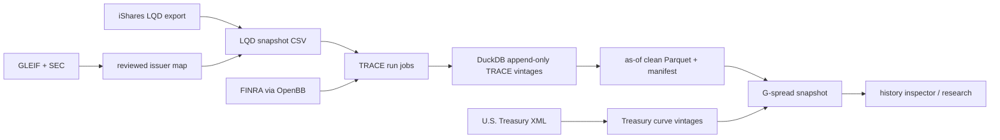

# Architecture

## Current system



| Layer | Current modules | Responsibility |
|---|---|---|
| Universe and identity | `lqd_holdings`, `build_lqd_snapshot`, `resolve_lqd_tickers`, `mapping_app` | Produce a dated pilot universe and review issuer mappings. |
| Collection | `trace_history`, `trace_history_app` | Run/resume TRACE history acquisition, append retrieval vintages, and freeze each input snapshot. |
| Government curves | `treasury_curves` | Retrieve U.S. Treasury par-yield nodes into a separate, versioned DuckDB table. |
| Data quality | `data_preprocessing`, `trace_cleaning`, `trace_preprocessor` | Apply versioned field rules and write a clean derivative. |
| Spreads | `spread_snapshot` | Bind exact TRACE and Treasury vintages, interpolate by remaining maturity, and preserve a spread snapshot plus manifest. |
| Exploration | `trace_history_inspector`, `lqd_inspector` | Plot individual series and cross-sectional level summaries. |
| Operations | `launcher` | Start local GUIs and expose diagnostics. |

## Data contracts

The stable analysis key is `(instrument_id, trade_date, retrieval_id)`. TRACE versions are stored append-only, with retrieval time, source run, and a normalized-record hash. The existing `observations` table remains a latest-value compatibility table while older readers migrate.

TRACE runs archive and hash their input holdings snapshot. The interactive LQD build itself currently writes a replaceable `lqd_bonds.csv`; treat its source date and content hash as required run metadata until it too writes content-addressed baseline/final manifests. Preprocessing selects the observation versions known at the run cutoff and records the cleaning policy. Treasury curve runs are stored separately. Each spread snapshot names both input vintages, records the interpolation policy and hashes, and has an immutable manifest and Parquet output. Keep instrument master, as-of-dated universe membership, vendor observations, derived datasets, and research outputs separate.

## Target shape

```text
src/parallax/
  domain/       # typed identifiers, units, schemas
  providers/    # FINRA, holdings, GLEIF/SEC adapters
  storage/      # DuckDB schema, repositories, manifests
  pipelines/    # snapshot, collection, cleaning
  research/     # returns, signals, validation
  ui/           # Qt windows only
tests/
docs/
```

First extract schemas, provider protocols, and a storage repository; then make GUI modules thin clients of those services.
