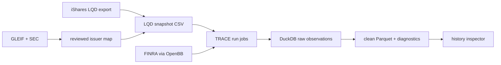

# Architecture

## Current system



| Layer | Current modules | Responsibility |
|---|---|---|
| Universe and identity | `lqd_holdings`, `build_lqd_snapshot`, `resolve_lqd_tickers`, `mapping_app` | Produce a dated pilot universe and review issuer mappings. |
| Collection | `trace_history`, `trace_history_app` | Run/resume history acquisition and preserve source observations. |
| Data quality | `data_preprocessing`, `trace_cleaning`, `trace_preprocessor` | Apply versioned field rules and write a clean derivative. |
| Exploration | `trace_history_inspector`, `lqd_inspector` | Plot individual series and cross-sectional level summaries. |
| Operations | `launcher` | Start local GUIs and expose diagnostics. |

## Data contracts

The stable analysis key should be `(instrument_id, trade_date, data_vintage)`. Today raw observations are keyed by `(isin, trade_date)`; that supports a latest view but does not preserve vendor corrections or make an old run fully reproducible.

Keep instrument master, as-of-dated universe membership, vendor observations, derived datasets, and research outputs separate.

## Target shape

```text
src/parallax/
  domain/       # typed identifiers, units, schemas
  providers/    # FINRA, holdings, GLEIF/SEC adapters
  storage/      # DuckDB schema, repositories, manifests
  pipelines/    # snapshot, collection, cleaning
  research/     # returns, signals, validation
  ui/           # Qt windows only
tests/
docs/
```

First extract schemas, provider protocols, and a storage repository; then make GUI modules thin clients of those services.
